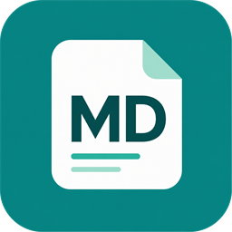
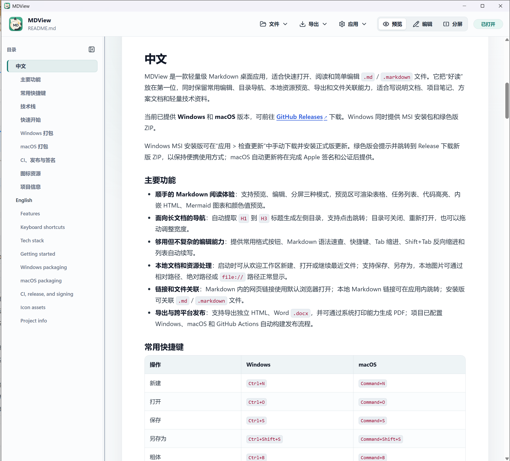
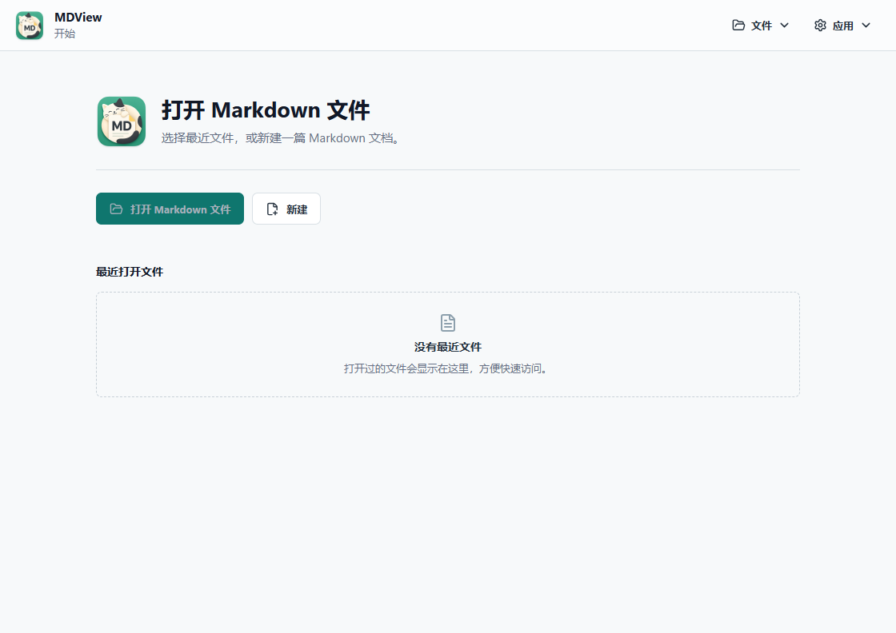

<div align="center">
  
  <h1>MDView</h1>
  <p><strong>面向 AI 场景的轻量 Markdown 阅读器。</strong><br />A lightweight Markdown reader for AI workflows.</p>
  <p>美观易读 · 打开轻快 · 免费无广告<br />Beautifully readable · Quick to open · Free and ad-free</p>
  <p>
    <a href="https://github.com/isunky/MDView/releases/latest"></a>
    <a href="LICENSE"></a>
    
  </p>
  <p>
    <a href="#中文">中文</a>
    · <a href="#english">English</a>
    · <a href="#ai-build">AI 辅助编译 / Build with AI</a>
  </p>
  <p>
    <a href="https://github.com/isunky/MDView/releases/latest"></a>
    &nbsp;
    <a href="docs/USER_GUIDE.zh-CN.md"></a>
  </p>
  <p><strong>Version / 版本：</strong>3.7.3 · <a href="https://www.sunky.net">Sunky</a></p>
</div>

## 界面预览 / Preview

<table>
  <tr>
    <td width="50%" align="center">
      <a href="docs/assets/screenshots/main2.png"></a>
      <br /><sub>阅读工作区 / Reading workspace</sub>
    </td>
    <td width="50%" align="center">
      <a href="docs/assets/screenshots/main.png"></a>
      <br /><sub>欢迎页 / Welcome screen</sub>
    </td>
  </tr>
</table>

## 中文

**给 Markdown 一个好读的地方。**

首次使用或想了解更多操作，可查看[图文使用手册](docs/USER_GUIDE.zh-CN.md)。

AI 写好的方案、平时积累的笔记，或是项目里的技术文档，用 MDView 打开就能舒舒服服地读。它是一款轻量的 Markdown 阅读器，界面简洁，打开轻快，免费无广告，也不需要注册账号。遇到需要修改的地方，直接编辑；整理好之后，也可以转换成便于分享的文档。

### 收到一份 AI 生成的长文，先好好读一遍

让 AI 帮忙整理了一份方案、报告或学习笔记？把内容保存为 `.md` 或 `.markdown` 文件，用 MDView 打开，正文、表格、任务列表和代码就能清晰呈现。阅读时可以调整字体、字号、行距、正文宽度和缩放；主题支持浅色、深色或跟随系统，桌面版还可以使用电脑中已安装的字体。

内容很长也不用反复翻找：左侧目录可以直接跳到需要的章节，当前章节会随正文滚动高亮。目录可以关闭、调整宽度和显示层级；下次打开同一文件，还能回到上次的阅读位置和视图。

### 看技术文档时，图表和公式都在原处

阅读接口说明、架构设计或数据分析笔记时，Mermaid 图表、LaTeX 公式、代码和表格都能直接看，不必先转换格式。支持的颜色值旁还会显示对应色块，看设计规范或配色方案更直观。文档引用的本地图片和相对路径 Markdown 文件，也可以直接查看或打开。

想看清图片或图表的细节，可以打开独立预览，缩放、拖动，或按文档顺序前后浏览。普通图片支持按原格式保存，Mermaid 图表则可保存为完整的 PNG，不受预览时的缩放和拖动影响。

### 一边查资料，一边继续手头的工作

写代码、做笔记或整理材料时，可以把 MDView 窗口置顶，让参考文档留在眼前。最近打开的文件也能随时找回，或直接定位到所在文件夹。

### 读到需要修改的地方，直接动手

发现一处需要修改？切到编辑模式就能动手，也可以打开分屏，边写边看效果。两侧内容支持同步滚动，分隔线可拖动调整宽度。标题、列表、链接、表格和公式都有快捷入口，图片也可以粘贴、拖入或批量选择。

查找时可以查看匹配数量、在结果间跳转，编辑模式还支持替换和全部替换。常用快捷键、撤销重做和内置语法参考都在手边；状态栏会显示字数、字符数、光标位置和预计阅读时长，保存状态也一目了然。

### 文档留在本地，修改有迹可循

文档保存在自己的设备上。需要整理最近文件列表时，可以移除记录，或暂时隐藏文件名和路径。文件被其他程序修改时，MDView 会提醒你处理，避免无意覆盖。未保存的内容会备份为本地草稿，重新启动时可选择恢复，再由你决定何时保存到文件。

### 接到 Word 材料，整理后再分享

手头有 Word 文档？可以将 `.docx` 导入为 Markdown 草稿，修改后保存成 `.md`，原文件不会被改动。转换在本机进行；首次使用时需要准备 Python 和转换组件，下载组件需要联网。

整理好内容后，可以导出排版整洁的 Word、独立 HTML，或通过系统打印生成 PDF。导出前会说明格式差异，例如 Word 中的 Mermaid 图表会保留为代码。导出 HTML 或 Word 后，也可以直接打开文件或所在文件夹。

更多产品设计背景可阅读[《给 Markdown 一个好读的家：我为什么做了 MDView》](docs/articles/MDView-wechat-intro.zh-CN.md)。

## English

**A comfortable place to read Markdown.**

Whether it's an AI-generated plan, a collection of notes, or project documentation, MDView makes it easy to settle in and read. It's a lightweight Markdown reader with a clean interface: quick to open, free and ad-free, with no account required. When something needs changing, you can edit it on the spot or turn it into a document that's ready to share.

### Read an AI-generated document from start to finish

Turn an AI-generated plan, report, or study note into an `.md` or `.markdown` file, then open it in MDView to read the text, tables, task lists, and code in a clear layout. Choose a light, dark, or system theme, adjust the typography and zoom, or use a font already installed on your computer in the desktop app.

Use the outline to find your way through a long document; the current section stays highlighted as you scroll. Hide it when you need more room, or adjust its width and heading depth. When you come back to the file, MDView picks up your reading position and view.

### Explore diagrams and formulas in technical documents

When reading an API reference, architecture design, or analysis note, Mermaid diagrams, LaTeX formulas, highlighted code, and tables are ready to read without conversion. Supported color values come with a matching swatch, which is handy for design specifications and palettes. You can also view local images and open relative Markdown links from the document.

Need a closer look? Open an image or Mermaid diagram in the viewer to zoom, pan, fit it to the window, or browse forwards and backwards through the document. Save ordinary images in their original format, or save a complete Mermaid diagram as a PNG regardless of the current zoom and pan.

### Keep a reference nearby while you work

Writing code, taking notes, or preparing materials? Pin the MDView window on top to keep the reference visible. Recent files are easy to reopen, and you can reveal their folders directly.

### Make changes as you read

Spot something to change? Switch to the source editor, or open split view to write and preview side by side. The two panes can scroll together, and you can drag the divider to resize them. Shortcuts are available for headings, lists, links, tables, images, and formulas; images can also be pasted, dropped, or inserted in batches.

Find shows how many matches there are and lets you move between them; in the editor, you can also replace one or all matches. Undo and redo, common keyboard shortcuts, and a built-in syntax reference are close at hand. The status bar shows word and character counts, cursor position, and estimated reading time, and the save state stays visible.

### Keep local files and edits under control

Your documents stay on your device. You can remove recent-file entries or temporarily hide their names and paths. If another app changes a file, MDView warns you before an accidental overwrite. Unsaved work is backed up locally and can be restored on the next launch; you remain in control of when to save it to a file.

### Turn Word materials into something ready to share

Have a Word document to work with? Import a `.docx` as a Markdown draft, edit it, and save it as `.md`; the original Word file stays untouched. Conversion takes place locally. First-time setup requires Python and conversion components, and downloading those components requires internet access.

When you're ready to share, export a neatly formatted Word document or standalone HTML, or use system printing to create a PDF. MDView explains format differences before export: for example, Mermaid diagrams are kept as code in Word. After exporting HTML or Word, you can open the file or its folder straight away.

## 下载与安装 / Installation

从 [GitHub Releases](https://github.com/isunky/MDView/releases/latest) 选择适合的版本。 / Choose a package from GitHub Releases.

| 平台 / Platform | 推荐方式 / Recommended option |
| --- | --- |
| Windows | **MSI**：安装、文件关联与更新检查 / Installer, file associations, and update checks |
| Windows 绿色版 / Portable | **ZIP**：解压后运行 / Extract and run |
| macOS | **[本机源码编译 / Local build](#macos-build)**：推荐使用 AI 编程工具辅助 / AI-assisted build recommended |
| Microsoft Edge | **Extension ZIP**：解压后加载 / Extract and load unpacked |

**Windows：**需要预先安装 [WebView2 Runtime](https://developer.microsoft.com/en-us/microsoft-edge/webview2/)，MDView 不附带或下载运行时。MSI 安装界面为英文；应用支持简体中文、繁体中文、韩语、日语、西班牙语和英语，首次启动跟随系统语言，也可在「应用」菜单中切换并记住选择。

安装版可在「应用」菜单中手动检查更新并安装新版；绿色版可检查更新并前往 Release 页面下载新版 ZIP。MSI 安装时可选择关联 Markdown 文件，之后双击文件即可打开。

**macOS：**因发布包尚未完成 Apple 签名与公证，建议在自己的 Mac 上[通过 AI 辅助编译](#ai-build)。本地构建仍可能出现系统安全提示。

<details>
<summary>English installation notes</summary>

Windows requires WebView2 Runtime to be installed separately; MDView does not bundle or download it. The MSI uses an English installer. The app supports Simplified Chinese, Traditional Chinese, Korean, Japanese, Spanish, and English, follows your system language on first launch, and remembers changes made in the App menu.

Use the App menu to check for updates: the MSI edition can install an available update, while the portable edition opens the Release page to download the new ZIP. The MSI also offers Markdown file association during installation.

The macOS Universal DMG supports Intel and Apple Silicon on macOS 10.15+. It uses ad-hoc signing without Developer ID signing or Apple notarization and may be blocked by macOS. We recommend building from source on your own Mac.

</details>

<details>
<summary>Edge 扩展与 Windows 部署 / Edge and Windows deployment</summary>

**Edge：**在 `edge://extensions` 开启开发人员模式，选择“加载解压缩的扩展”，选中解压后含 `manifest.json` 的文件夹。

**Edge:** enable Developer mode at `edge://extensions`, choose **Load unpacked**, and select the extracted folder containing `manifest.json`.

**Windows：**MSI 默认关联 `.md` 和 `.markdown`，安装时可取消。静默安装时可通过以下参数禁用关联，请替换为实际 MSI 文件名。

**Windows:** Markdown associations are enabled by default and can be deselected. To disable them during unattended installation, replace the example filename below with your MSI:

```powershell
msiexec /i MDView_x64.msi ASSOCIATE_MARKDOWN_FILES=0 /qn
```

签名状态以各版本发布说明为准；详见[代码签名政策](CODE_SIGNING_POLICY.md)。 / See each release's signing status and the [code signing policy](CODE_SIGNING_POLICY.md).

</details>

<a id="macos-build"></a>
<a id="ai-build"></a>

## 用 AI 帮你编译 / Build with AI

无需先熟悉编译命令，让能操作本地终端的 AI 编程工具协助完成：

1. 从 [Releases](https://github.com/isunky/MDView/releases/latest) 下载 **Source code (zip)** 并解压。
2. 用 AI 编程工具打开解压后的项目文件夹。Mac 版本需在 Mac 上编译，Windows 版本需在 Windows 上编译。
3. 发送下方对应的提示词，按提示完成必要的环境安装，等待 AI 给出安装包位置。

首次准备环境与下载依赖需要联网。

**Mac 提示词**

```text
请帮我将当前文件夹中的 MDView 源码编译为这台 Mac 可安装的版本。

先阅读项目构建说明，检查本机环境，说明缺失的依赖并协助安装。
使用项目现有构建配置生成适合这台 Mac 的 DMG 安装包。
遇到错误请定位原因、做必要修复并重试，保留我的已有修改。
沿用本地签名配置，不关闭系统安全机制，不上传或发布产物。
完成后确认安装包已生成，告诉我完整路径和安装方法；如未成功，请说明具体阻塞原因。
```

**Windows 提示词**

```text
请帮我将当前文件夹中的 MDView 源码编译为 Windows 安装版和绿色版。

先阅读项目构建说明，检查本机环境，说明缺失的依赖并协助安装。
优先使用项目现有的一键打包入口，生成 MSI、Portable ZIP 和校验文件。
遇到错误请定位原因、做必要修复并重试，保留我的已有修改。
使用本地打包配置，不要求发布签名密钥，不上传或发布产物。
完成后确认文件已生成，告诉我完整路径和使用方法，并检查运行所需的 WebView2 是否可用。
如未成功，请说明具体阻塞原因。
```

<details>
<summary>English instructions and ready-to-use prompts</summary>

Download a release's **Source code (zip)** and extract it. Open the project folder in an AI coding tool with local terminal access, then send the appropriate prompt below. Build on the target platform: macOS on a Mac, Windows on Windows. Initial setup requires internet access; follow any dependency installation steps the tool presents.

**macOS**

```text
Build the MDView source in this folder into an installable app for this Mac.

Read the project's build instructions, check the environment, and help install missing prerequisites.
Use the existing build configuration to create a DMG for this Mac's architecture.
Diagnose failures, make necessary fixes, and retry while preserving my existing changes.
Keep local signing settings and system security protections. Do not upload or publish artifacts.
Verify the DMG exists, then provide its full path and installation steps.
If the build cannot finish, explain the specific blocker.
```

**Windows**

```text
Build the MDView source in this folder into Windows installer and portable packages.

Read the project's build instructions, check the environment, and help install missing prerequisites.
Use the existing one-step packaging entry point to create an MSI, Portable ZIP, and checksums.
Diagnose failures, make necessary fixes, and retry while preserving my existing changes.
Use local build settings without release signing keys. Do not upload or publish artifacts.
Verify the files exist, provide their full paths and usage steps, and check WebView2 availability.
If the build cannot finish, explain the specific blocker.
```

</details>

<details>
<summary>Mac 环境、手动命令与签名 / Mac prerequisites, commands, and signing</summary>

准备 [Node.js 24](https://nodejs.org/en/download)、[Rust/Cargo 1.90 或更新的 stable 版本](https://rustup.rs/) 和 Xcode Command Line Tools；详见 [Tauri 环境要求](https://v2.tauri.app/start/prerequisites/)。

Install Node.js 24, Rust/Cargo 1.90 or newer (stable recommended), and Xcode Command Line Tools. See the Tauri prerequisites linked above.

```bash
# 仅在缺少 Apple 编译工具时执行 / Only if Apple's build tools are missing
xcode-select --install

# 在解压后的源码目录执行 / Run from the extracted source directory
npm ci
npm run desktop:build -- --bundles dmg
```

默认构建当前 Mac 架构的版本。签名机制参见 [Tauri macOS 签名说明](https://v2.tauri.app/distribute/sign/macos/)。

The default build targets your Mac's architecture. See the Tauri macOS signing guide above for signing details.

默认产物位于 `src-tauri/target/release/bundle/dmg/`，打开 DMG 后将 MDView 拖入“应用程序”。本地构建使用 ad-hoc 签名，不等于 Apple 公证，也不保证消除所有安全提示。

Find the DMG in `src-tauri/target/release/bundle/dmg/`, open it, and drag MDView into Applications. Local builds use ad-hoc signing, are not Apple-notarized, and may still show security prompts.

</details>

## 使用参考 / Reference

<details>
<summary>常用快捷键 / Keyboard shortcuts</summary>

| 操作 / Action | Windows | macOS |
| --- | --- | --- |
| 新建 / New | `Ctrl+N` | `Command+N` |
| 打开 / Open | `Ctrl+O` | `Command+O` |
| 保存 / Save | `Ctrl+S` | `Command+S` |
| 另存为 / Save As | `Ctrl+Shift+S` | `Command+Shift+S` |
| 查找 / Find | `Ctrl+F` | `Command+F` |
| 撤销 / Undo | `Ctrl+Z` | `Command+Z` |
| 重做 / Redo | `Ctrl+Y` / `Ctrl+Shift+Z` | `Command+Shift+Z` |
| 粗体 / Bold | `Ctrl+B` | `Command+B` |
| 斜体 / Italic | `Ctrl+I` | `Command+I` |
| 插入链接 / Insert link | `Ctrl+K` | `Command+K` |
| 缩进 / 反向缩进 / Indent / Outdent | `Tab` / `Shift+Tab` | `Tab` / `Shift+Tab` |

</details>

<details>
<summary>Word 导入 / Word import</summary>

Word 转换在本机完成。首次使用需要 Python 和转换组件，下载组件需要联网。

Word conversion runs locally. Initial setup requires Python and conversion components, with internet access for downloads.

</details>

<details>
<summary>数学公式 / Math formulas</summary>

使用 `$...$` 插入行内公式，单独成行的 `$$` 包裹公式块。编辑时点击 `Σ` 可使用公式模板与实时预览；普通美元符号写为 `\$`。

Use `$...$` for inline math and `$$` on separate lines for display math. Click `Σ` for templates and a live preview. Escape a literal dollar sign as `\$`.

</details>

<details>
<summary>开发与打包 / Development and packaging</summary>

技术栈 / Stack：Tauri 2 · React 19 · TypeScript · Vite。

准备 Node.js 24、Rust/Cargo 1.90 或更新版本和[对应平台构建工具](https://v2.tauri.app/start/prerequisites/)，在源码目录运行： / Install Node.js 24, Rust/Cargo 1.90 or newer, and platform build tools, then run from the source directory:

```bash
npm ci
npm run desktop:dev
```

| 目标 / Target | 命令 / Command |
| --- | --- |
| Windows MSI | `npm run desktop:build -- --bundles msi` |
| Windows MSI + Portable ZIP + SHA-256 | `npm run package:windows` |
| macOS DMG | `npm run desktop:build -- --bundles dmg` |
| Edge ZIP | `npm run edge:package` |

验证命令 / Verification：`npm test` · `npm run lint` · `npm run build` · `npm run test:e2e`。

版本管理 / Versioning：`npm run version:sync -- <major.minor.patch>`，然后 / then `npm run version:check`。

维护者资料 / Maintainer docs: [`ROADMAP.md`](ROADMAP.md) · [`工程目录说明 / Project structure`](docs/PROJECT_STRUCTURE.md)。

</details>

<details>
<summary>CI、发布与签名 / CI, releases, and signing</summary>

普通推送与 PR 执行质量检查；手动运行 CI 额外生成桌面安装包。推送 `v*` Tag 或运行 Release 工作流可发布 GitHub Release。

Pushes and PRs run quality checks; manual CI runs also build desktop installers. A `v*` tag or the Release workflow publishes a GitHub Release.

| 集成 / Integration | 配置 / Configuration |
| --- | --- |
| Windows SignPath | Secret: `SIGNPATH_API_TOKEN`；Variable: `SIGNPATH_ORGANIZATION_ID` |
| Tauri updater | Secrets: `TAURI_SIGNING_PRIVATE_KEY`、`TAURI_SIGNING_PRIVATE_KEY_PASSWORD` |
| Edge Add-ons | Secret: `EDGE_ADDONS_API_KEY`；Variables: `EDGE_ADDONS_CLIENT_ID`、`EDGE_ADDONS_PRODUCT_ID` |

SignPath 签名仅用于 Release，需完成配置与审批；Edge 首次发布需在 Microsoft Partner Center 创建产品。macOS Developer ID 签名与公证尚未配置。

SignPath signing applies to releases after configuration and approval. Create the initial Edge product in Microsoft Partner Center. macOS Developer ID signing and notarization are not yet configured.

</details>

## 项目信息 / Project

| 项目 / Item | 内容 / Value |
| --- | --- |
| 当前版本 | 3.7.3 |
| Version | 3.7.3 |
| 作者 / Author | [Sunky](https://www.sunky.net) |
| 许可证 / License | [GPL-3.0](LICENSE) |

第三方依赖保留原许可证。 / Third-party dependencies retain their original licenses.
