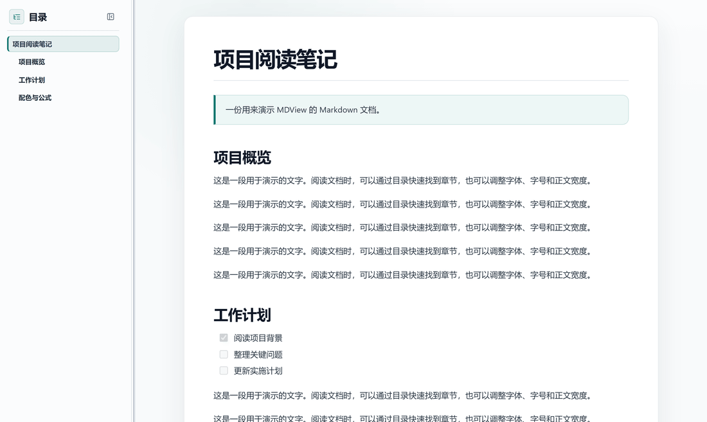
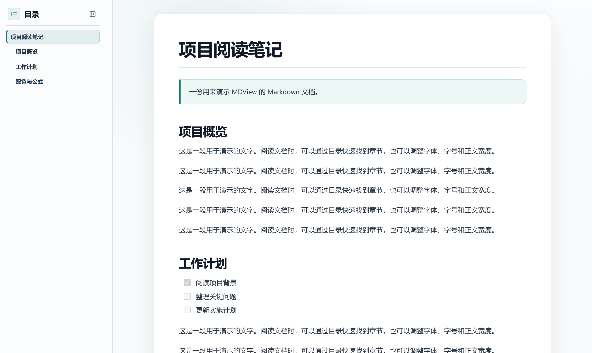
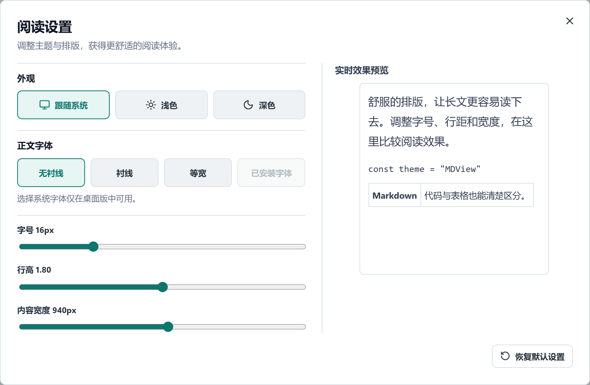
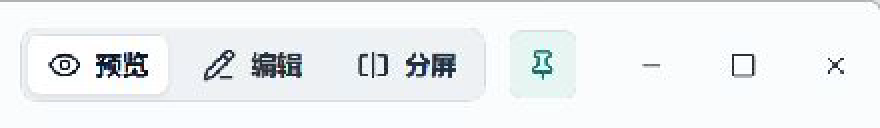
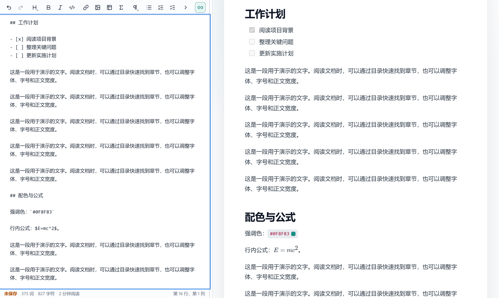
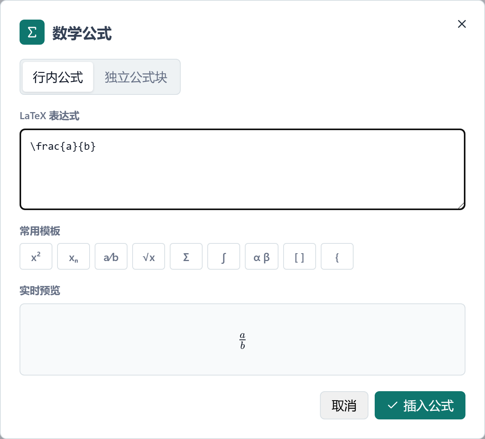
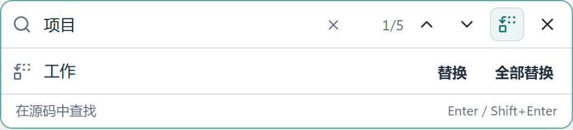

# MDView 使用手册

从打开第一份 Markdown 文件开始，到阅读、编辑和分享文档，这份手册会带你走一遍 MDView 的常用操作。不需要提前掌握 Markdown；遇到不熟悉的写法，也可以在应用里查看语法参考。

手册中的局部图片使用演示文档，在浏览器预览界面截取；桌面版的窗口控制、文件选择和系统字体等功能以实际桌面界面为准。动图由操作前后的两帧截图组成，用来展示目录跳转的效果。

## 目录

- [1. 安装与开始使用](#1-安装与开始使用)
- [2. 打开并阅读文档](#2-打开并阅读文档)
- [3. 查看图片、图表和公式](#3-查看图片图表和公式)
- [4. 修改与整理内容](#4-修改与整理内容)
- [5. 保存与保护文件](#5-保存与保护文件)
- [6. 导入、导出与更新](#6-导入导出与更新)
- [7. 常用快捷键](#7-常用快捷键)
- [8. 常见问题](#8-常见问题)

## 1. 安装与开始使用

### 选择适合自己的版本

前往 [GitHub Releases](https://github.com/isunky/MDView/releases/latest)，根据设备选择：

| 版本 | 适合谁 | 怎么开始 |
| --- | --- | --- |
| Windows MSI 安装版 | 希望像普通软件一样安装，并使用文件关联和应用内更新 | 运行 MSI，按安装向导完成安装。可选择关联 `.md` 和 `.markdown` 文件。 |
| Windows 绿色版 | 不想安装，希望解压后直接使用 | 下载 Portable ZIP，解压到一个文件夹，运行其中的 MDView。检查更新后需要自行下载新版 ZIP。 |
| macOS | 在 Mac 上阅读和编辑 | 项目提供 Universal DMG，支持 Intel 和 Apple Silicon。由于发布包尚未完成 Apple Developer ID 签名与公证，推荐在自己的 Mac 上从源码构建；见 [README 中的 AI 辅助编译说明](../README.md#ai-build)。 |
| Microsoft Edge 扩展 | 希望在 Edge 中使用 | 下载扩展 ZIP 并解压；打开 `edge://extensions`，开启开发人员模式，选择“加载解压缩的扩展”，再选择包含 `manifest.json` 的文件夹。 |

Windows 桌面版运行前需要 [Microsoft Edge WebView2 Runtime](https://developer.microsoft.com/en-us/microsoft-edge/webview2/)。安装包和绿色版不会附带或自动下载它；电脑缺少运行时，请先安装。

> **Tip：**安装版选择了文件关联后，可以在资源管理器里双击 Markdown 文件直接打开 MDView；如果系统仍使用其他程序，可在 Windows 的“打开方式”中选择 MDView。

### 第一次打开

启动后，欢迎页可以打开 Markdown 文件、新建文档或选择最近打开的文件。Markdown 是一种用普通文本书写标题、列表和链接等内容的格式，常见扩展名是 `.md` 或 `.markdown`。

首次启动时，界面会尝试跟随系统语言。需要切换时，打开顶部的 **应用** 菜单，选择简体中文、繁体中文、英语、日语、韩语或西班牙语；应用会记住你的选择。

> 本手册主要以 Windows 桌面版操作为例。macOS 的常用快捷键使用 `Command`；Edge 扩展受浏览器权限和接口限制，窗口置顶、系统字体、桌面更新等原生能力不适用，文件操作也可能有所不同。

### 先认识一下界面

窗口顶部的 **文件、阅读、应用** 三个菜单分别放着文件与导出、查找与阅读设置、语言与更新等操作。打开或新建文档后，右侧可以切换 **预览、编辑、分屏**：

| 视图 | 什么时候用 |
| --- | --- |
| 预览 | 专心阅读排版后的文档，使用左侧目录浏览。 |
| 编辑 | 直接修改 Markdown 源码，使用编辑工具栏。 |
| 分屏 | 左边写、右边看效果，也可以开启同步滚动。 |

鼠标停在图标按钮上，会显示按钮名称。窗口宽度较小时，部分按钮可能只显示图标；编辑工具栏的内容放不下时，可以点击右侧箭头查看其余工具。

> **Tip：**习惯用键盘时，可以先用 `Tab` 移到顶部菜单，再用上下方向键打开并选择菜单项；左右方向键可在菜单之间切换，`Esc` 关闭菜单并回到菜单按钮。

### 在 Edge 中打开当前页面

安装 Edge 扩展后，浏览网页或 Markdown 文件时，可以点击浏览器工具栏中的 MDView 扩展图标，或在页面空白处右键选择 **Open current page in MDView**，在新的扩展页面中查看提取到的内容。需要保留内容时，使用 **另存为** 选择保存位置。

这个入口提取的是页面中的文本，不是保留原网页样式和交互的完整网页转换。浏览器保护的页面、没有获得访问权限的页面可能只会打开空工作区；打开本地 `file:` 页面时，浏览器可能要求授予文件访问权限。扩展的图片导入和定位本地文件夹等能力与桌面版不同。

## 2. 打开并阅读文档

### 打开文件和最近记录

1. 在欢迎页点击 **打开 Markdown 文件**，或者打开顶部 **文件** 菜单并选择打开。
2. 选择一份 `.md` 或 `.markdown` 文件。打开后，默认可以直接阅读排版结果。
3. 再次使用时，可从欢迎页或 **文件 → 最近文件** 选择它。暂时找不到文件时，可以重试或重新定位；也可以移除记录。

> **Tip：**不想在旁人面前显示最近文件名称和路径时，可在最近文件区域暂时隐藏；这不会删除原文件。

在最近文件列表中，将鼠标移到文件条目上，点击右侧的文件夹图标，就能打开文件所在的文件夹；文件已经移动或失效时，可以使用定位入口重新选择。单条记录旁的移除按钮和列表上的清空按钮只整理记录，不会删除磁盘上的文档。


*Windows 桌面版局部：选中或指向文件条目后，右侧显示文件夹定位图标。*

### 用目录浏览长文

阅读视图左侧的目录根据文档标题生成。点击章节，即可跳到正文对应位置；向下滚动时，目录会高亮当前章节。



*目录跳转示意：选择左侧章节，右侧定位到相应内容。*



*阅读视图局部：左侧是目录，右侧是排版后的正文。*

- 点击“目录”旁的层级图标，可选择显示到 H1 至 H5，也可全部展开或折叠有子章节的目录。默认显示到 H3；选择 H2 时只看一级、二级标题，选择 H5 可看到更细的结构。
- 双击带子章节的目录项，可单独展开或收起；右键可操作该章节的子目录。
- 拖动目录与正文之间的边界可以调整宽度；不需要目录时，点击目录头部的收起按钮。

> **Tip：**目录只会显示文档中识别到的标题，不会把普通加粗文字当成章节。重新打开同一路径的文件时，MDView 会尽量恢复阅读位置、视图、缩放以及目录宽度和开关状态；新建但尚未保存的文档还没有可关联的文件路径。

不使用鼠标时，可用 `Tab` 将焦点移到目录与正文之间的分隔线上，再用左右方向键调整目录宽度。收起整个目录后，点击正文左侧的展开按钮即可找回。

想自己写一个能进入目录的标题？在编辑模式中新起一行，输入 `# 标题` 或 `## 小标题`，注意 `#` 后面留一个空格。目录支持显示到五级标题；编辑工具栏的标题按钮可快速插入一级至四级标题，五级可以手动输入 `##### 标题`。

### 调整阅读外观

打开顶部 **阅读 → 阅读设置**，可以选择浅色、深色或跟随系统，并调整正文字体、字号、行距和内容宽度。设置窗口中会显示实时预览；需要重新开始时，点击 **恢复默认设置**。



*阅读设置局部。图中为浏览器预览，因此“已安装字体”不可用；Windows 和 macOS 桌面版可选择系统字体。*

在预览区还可按住 `Ctrl` 并滚动鼠标滚轮缩放，底部会短暂显示缩放比例。字体和排版设置改变的是阅读外观，不会改写 Markdown 文件。

“内容宽度”决定正文最多占多宽，不会改变应用窗口大小。看长段落时可以调窄一些，看宽表格时可以调宽；表格仍放不下时，可在表格区域横向滚动。选择“已安装字体”需要桌面版，打开列表后可搜索字体名称。

### 工作时保持文档可见

在 Windows 或 macOS 桌面版，点击顶部的图钉按钮可切换 **窗口置顶**。启用后，MDView 会保持在普通窗口前面；再次点击即可取消。应用会记住这个选择。系统安全窗口或其他置顶窗口仍可能出现在前面。



*Windows 桌面版局部：图钉高亮表示窗口置顶已开启。*

## 3. 查看图片、图表和公式

### 图片和文档链接

Markdown 可以通过相对路径引用图片，例如 ``。桌面版会以 Markdown 文件所在位置为基准查找图片；引用的其他本地 Markdown 文件也可以继续打开。网页链接会交给系统默认浏览器。

单击正文中的图片可打开大图预览；双击 Mermaid 图表也可打开独立预览。在预览中可以使用滚轮或按钮缩放、拖动查看细节，并在多张图片和图表之间前后切换。按 `Esc` 或点击关闭按钮返回正文。

预览窗口底部有缩小、放大、重置和保存按钮；多张图片或图表会显示当前位置，也可以用键盘左右方向键切换。重置会回到初始缩放和位置，方便看完细节后重新观察整体。

在独立预览窗口中，也可以用 `+` 或 `=` 放大、`-` 缩小，按 `0` 重置。使用键盘打开 Mermaid 图表时，将焦点移到图表后按 `Enter` 或空格即可进入预览。

> **Tip：**预览窗口中的保存按钮可以保存当前图片。普通图片保留原格式；Mermaid 图表保存为完整 PNG，不受预览缩放和拖动位置影响。

### 代码、颜色和公式

表格、任务列表、引用和代码块会按 Markdown 内容显示；代码块可显示语法颜色并提供复制入口。支持的十六进制颜色值旁会显示对应色块，查看设计配色时不必再打开取色工具。

> **Tip：**需要复制一整段命令或代码时，点击代码块右上角的 **复制** 即可，不必从头拖选到尾。宽表格可以在表格区域内横向滚动，不用为此放大整个窗口。

Mermaid 是一种用文字描述流程图等图表的方式；把它写在 `mermaid` 代码块中即可预览。数学公式支持 `$...$` 行内写法，以及用单独成行的 `$$` 包裹公式块。图表或公式无法显示时，先检查源内容和分隔符是否完整。

可以从这段简单的 Mermaid 示例开始：

````markdown

````

例如，`$E=mc^2$` 是行内公式；普通美元符号可写成 `\$`。颜色色块适用于识别到的十六进制颜色值，例如 `#0F8F83`；代码块里的内容保持代码展示，不会逐个插入色块。

文档中的部分 HTML 内容也可以参与排版，但出于安全考虑，脚本、事件属性和不安全的嵌入内容会被过滤，不应依赖它们执行网页功能。

如果文档使用了 HTML 的 `details` / `summary` 折叠内容，可以点击摘要文字展开或收起。普通网页链接会在默认浏览器中打开，方便在阅读和网页资料之间切换。

## 4. 修改与整理内容

### 在编辑和分屏之间切换

点击顶部的 **编辑**，直接修改 Markdown 源码；点击 **预览** 返回阅读视图。选择 **分屏** 时，左侧编辑、右侧预览，可以边写边看。



*分屏局部：左侧是 Markdown 源码，右侧显示排版结果。*

拖动两侧之间的分隔线可以调整宽度。编辑工具栏右侧的链条按钮控制同步滚动：开启时，滚动一侧会带动另一侧；对照不同位置时可以关闭。

> **Tip：**分屏宽度可以记住。双击分隔线可将两侧恢复为各占一半；用 `Tab` 选中分隔线后，也可用左右方向键微调，按 `Enter` 恢复各占一半。切换视图时，MDView 会尽量跟随当前阅读或编辑位置。

### 使用编辑工具

编辑器顶部提供撤销、重做、标题、粗体、斜体、代码、链接、图片、表格、公式、引用和列表等入口。选中文字后使用相应按钮，可以快速套用常见写法；插入表格时可在网格中选择行列数。

例如，要做一张简单的待办表：

1. 点击 **编辑** 或 **分屏**，把光标放在希望插入的位置。
2. 点击工具栏上的表格图标，在网格里选择所需行列；网格最多可选 6 行、6 列。
3. 在生成的表格中填写表头和内容；切换到预览或看右侧分屏，检查排版。

列表图标分别用于普通列表、编号列表和待办列表。选中多行后可使用 `Tab` 缩进，`Shift+Tab` 反向缩进；需要引用、代码块或分隔线时，可打开段落工具菜单。

忘了语法时，点击工具栏的 **Markdown 语法参考**，按分类查看示例并复制后修改。状态栏会显示字数、字符数、预计阅读时长、光标行列和保存状态。

点击 `Σ` 可打开公式编辑器，选择行内或独立公式，并使用分数、根号等模板。输入时可以先看实时预览，再插入正文。



*公式编辑器局部：选择模板后，可在预览中检查排版。*

插入公式的一个简单例子：点击 `Σ`，选择“行内公式”，点击分数模板，按需要修改 LaTeX 表达式；确认下方预览符合预期后，点击 **插入公式**。如果预览提示写法有误，先修改表达式，再尝试插入。

### 添加图片

在桌面版编辑文档时，可以点击图片按钮选择文件，也可以粘贴、拖入或批量插入图片。MDView 会将图片放到文档旁的 `assets` 文件夹，并插入相对路径；新文档尚未保存时，需要先确定保存位置。

操作时先把光标放在要插图的位置，再选择、粘贴或拖入图片。支持 PNG、JPEG、GIF、WebP、BMP 和 AVIF；单张不超过 10 MB，一次最多处理 10 张。导入时会显示进度；部分图片写入失败时，可在提示中重试失败项。遇到不支持的格式或超限图片，请先转换或压缩，再重新选择。

> **Tip：**移动或分享文档时，把 `.md` 文件和旁边的 `assets` 文件夹一起带走，相对路径图片才能继续被找到。

### 查找与替换

按 `Ctrl+F`（macOS 为 `Command+F`），或选择 **阅读 → 查找**。输入关键词后，查找栏会显示匹配数量，可切换上一个或下一个结果。在编辑模式中还可展开替换，逐个替换或全部替换。



*查找替换栏局部：上方是查找内容，下方填写替换后的文字。*

1. 输入要找的文字，查看当前结果和总数；按 `Enter` 跳到下一个，`Shift+Enter` 返回上一个。
2. 需要替换时，先切到编辑或分屏中的源码查找，再点击查找栏的替换图标。
3. 输入新文字，选择替换当前结果或全部替换。完成后可用撤销检查和调整；按 `Esc` 关闭查找栏。

> **Tip：**只想在阅读时定位，不需要改动内容，直接在预览中查找即可；替换入口只在源码查找时出现。

## 5. 保存与保护文件

### 保存与另存为

通过 **文件 → 保存** 或 `Ctrl+S`（macOS 为 `Command+S`）保存当前文档；第一次保存新文档时选择位置和文件名。**另存为** 可将内容保存到另一个位置，不必覆盖原文件。

新建文档第一次保存时，MDView 会尝试用文档中第一行有意义的内容作为建议文件名；如果是 Markdown 标题，不会把 `#` 标记带进文件名。你仍然可以在保存窗口中自行修改名称。

编辑时留意“未保存”“保存中”或“已保存”等状态。离开有未保存修改的文档时，应用会询问如何处理；需要继续保留修改时，先保存再离开。

> **Tip：**使用快捷键保存成功后，屏幕下方会短暂提示。若正准备新建或打开另一份文件，也可以在未保存提示中选择“保存并继续”，不必先取消再重新操作。

### 恢复草稿

未保存的修改会在本机备份为草稿。普通启动时如果发现可恢复的草稿，应用会询问是恢复还是放弃。恢复后内容仍是未保存状态，请检查后主动保存。

应用只保留最近一份未保存草稿；超过 90 天的草稿会被清理。草稿存放在本机应用存储中，不会同步到其他设备，也不是加密保险箱；清理应用数据可能使其消失。它是一层临时保护，重要内容仍建议及时保存并自行备份。

> **Tip：**如果原文件已无法读取，恢复内容会作为新的未命名文档打开，便于另存。通过文件关联直接打开某个文件时，应用优先打开该文件，旧草稿保留到下次普通启动；开始编辑新文件后，较新的草稿会替换旧草稿。

### 文件被其他程序修改

例如，你用其他编辑器或 AI 工具修改了当前文件。桌面版会检测磁盘变化：没有未保存修改时可更新内容；如果本地也有未保存修改，应用会提示冲突，让你选择保留当前编辑或重新载入磁盘版本。处理冲突前，先确认哪一份内容需要保留。

如果选择重新载入，当前未保存的编辑会被磁盘版本替换；如果选择保留当前编辑，之后保存到原文件会覆盖磁盘上的外部版本。两份内容都需要时，请先分别备份或另存，再决定如何处理。文件已经被移动或删除时，可检查原位置，或将需要保留的内容另存到新位置。“外部修改提醒”不是版本历史，也不会替你合并两份文档。

## 6. 导入、导出与更新

### 将 Word 转为 Markdown

1. 在 **文件** 菜单中选择 **导入 Word（.docx）**。
2. 首次使用时按窗口提示准备 Python 和本地转换组件。下载组件需要联网；准备完成后可在本机离线转换。
3. 选择 `.docx` 文件，等待转换完成。结果会作为未保存的 Markdown 草稿打开，原 Word 文件不会被改动。
4. 检查标题、表格、图片等内容，必要时调整，再保存为 `.md`。

转换需要 Python 3.10 或更高版本。导入窗口会显示转换器是否就绪，也提供重新检查和选择 Python 的入口；如果自动准备不成功，可以按窗口提示手动处理。复杂 Word 排版与 Markdown 的表达方式不同，转换后建议逐段检查，不应期待所有版式完全一致。

### 导出并分享

打开 **文件** 菜单，在导出区域选择：

| 格式 | 适合的情况 | 需要注意 |
| --- | --- | --- |
| Word（`.docx`） | 对方需要继续编辑文档 | Mermaid 图表会保留为代码；部分复杂公式可能使用图片或文本回退，导出后请检查提示和排版。 |
| HTML | 希望对方用浏览器阅读 | 尽量将所需样式和可读取的资源放进独立文件；未能嵌入的图片会有提示。 |
| PDF | 需要打印或定稿 | MDView 会准备打印页面并打开系统打印窗口，在其中选择保存为 PDF。 |

HTML 和 Word 导出完成后，可直接打开导出的文件或所在文件夹。复杂文档建议在分享前检查图片、公式和分页。

> **Tip：**希望读者看到 Mermaid 图形时，优先考虑 HTML 或 PDF；希望对方继续在 Word 中修改文字时，选择 Word 并留意图表以代码保留的提示。导出 HTML 时，如果某些图片无法读取或嵌入，应用会提示，不要忽略这条信息。

### 检查更新

Windows 版可从 **应用 → 检查更新** 手动检查。MSI 安装版发现新版后可在应用内下载安装；安装前请先保存未保存的文档，安装过程可能关闭应用。绿色版检查到更新后，前往 Release 页面下载并解压新版 ZIP。

macOS 和浏览器版本目前不提供同样的应用内安装更新流程，请查看 [Release 页面](https://github.com/isunky/MDView/releases/latest) 或按项目构建说明更新。

## 7. 常用快捷键

| 操作 | Windows | macOS |
| --- | --- | --- |
| 新建 / 打开 | `Ctrl+N` / `Ctrl+O` | `Command+N` / `Command+O` |
| 保存 / 另存为 | `Ctrl+S` / `Ctrl+Shift+S` | `Command+S` / `Command+Shift+S` |
| 查找 | `Ctrl+F` | `Command+F` |
| 撤销 / 重做 | `Ctrl+Z` / `Ctrl+Y` 或 `Ctrl+Shift+Z` | `Command+Z` / `Command+Shift+Z` |
| 粗体 / 斜体 | `Ctrl+B` / `Ctrl+I` | `Command+B` / `Command+I` |
| 插入链接 | `Ctrl+K` | `Command+K` |
| 有序 / 无序列表 | `Ctrl+Shift+7` / `Ctrl+Shift+8` | `Command+Shift+7` / `Command+Shift+8` |
| 缩进 / 反向缩进 | `Tab` / `Shift+Tab` | `Tab` / `Shift+Tab` |

编辑器工具栏和菜单中的提示也会显示常用快捷键。

## 8. 常见问题

### 图片显示不出来？

先确认图片文件仍在原位置，路径和文件名没有拼错。相对路径以 Markdown 文件所在文件夹为基准；移动文档时，记得把图片文件夹一起移动。来自其他电脑的绝对路径可能在当前设备上不存在，需要改成当前可访问的路径。网页图片还受网络与来源站点影响。

### 双击 Markdown 文件没有打开 MDView？

确认使用的是 Windows 安装版，并在安装时启用了文件关联；也可以在文件的“打开方式”中选择 MDView。绿色版通常需要自行选择打开方式。Edge 扩展不是桌面文件关联程序。

### Windows 上安装完成后无法启动？

先确认电脑已安装 [WebView2 Runtime](https://developer.microsoft.com/en-us/microsoft-edge/webview2/)。MDView 安装包不会安装或下载这个运行时；安装后重新启动应用再试。

### macOS 提示无法验证或无法打开？

当前发布包尚未完成 Apple Developer ID 签名与公证，macOS 可能显示安全提示。建议核对下载来源，并在自己的 Mac 上按 [README 的 AI 辅助编译说明](../README.md#ai-build)构建；本地构建也不保证完全消除安全提示。不要为此关闭整个系统的安全保护。

### Word 导入时提示缺少组件？

打开导入窗口，按提示准备 Python 和转换组件；首次下载需要联网。已经安装合适的 Python 时，也可以在导入窗口中选择可执行文件后重新检查。转换成功后仍需检查草稿并主动保存。

### 为什么没有看到某个标题或想要的字体？

目录只读取 Markdown 标题，先检查标题是否位于代码块之外，以及 `#` 后是否有空格；再点击目录头部的层级图标，确认没有把该级标题隐藏。系统字体列表仅在支持该能力的桌面版中可用；如果没有找到字体，确认它已经安装在当前电脑，必要时重启应用后再查找。

### 为什么没有出现恢复草稿的提示？

草稿只保留最近一份，超过 90 天会清理；主动保存、放弃修改、清理应用数据等情况也可能使相应草稿不再可恢复。若是双击文件启动，应用会先打开指定文件，旧草稿通常留到下次普通启动时处理。重要文档请保留独立备份。

### 为什么更新或窗口置顶按钮不可用？

应用内下载安装更新目前面向 Windows MSI；绿色版需要下载新版 ZIP，macOS 和浏览器版本不支持同样的安装流程。窗口置顶是桌面窗口功能，浏览器预览和 Edge 扩展不显示该按钮。

---

返回 [MDView 项目主页](../README.md)。
