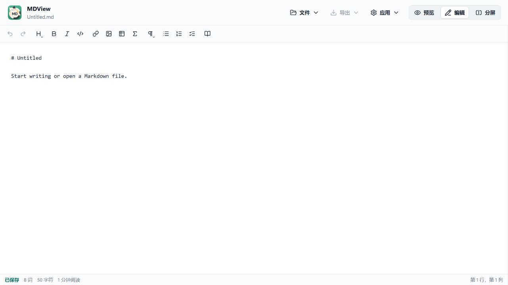
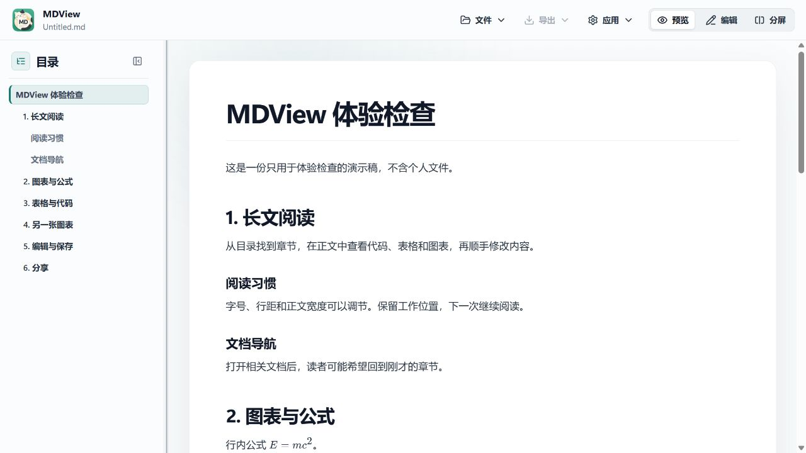
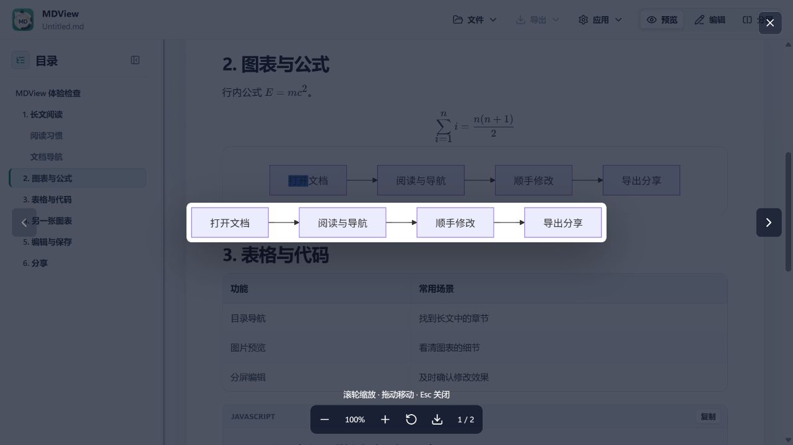
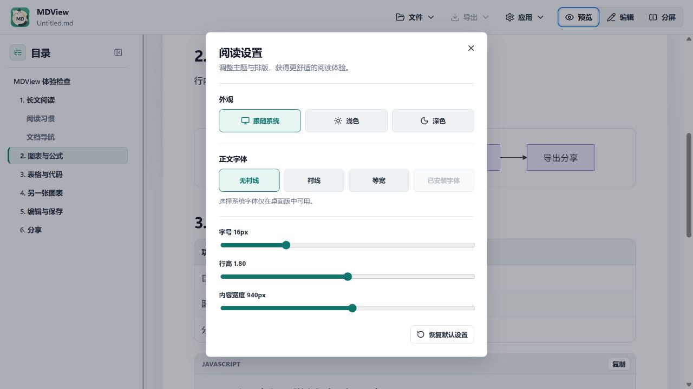
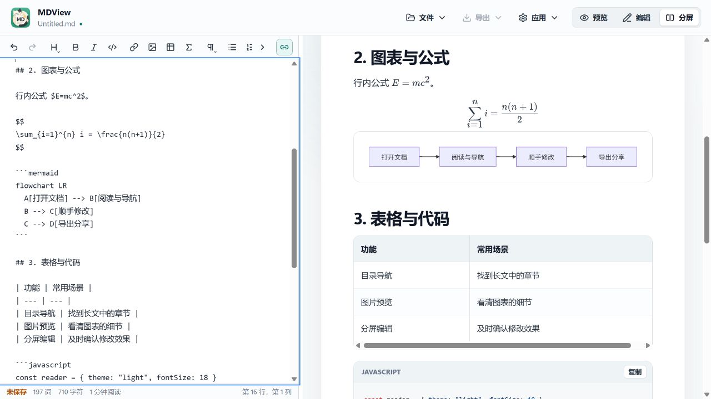
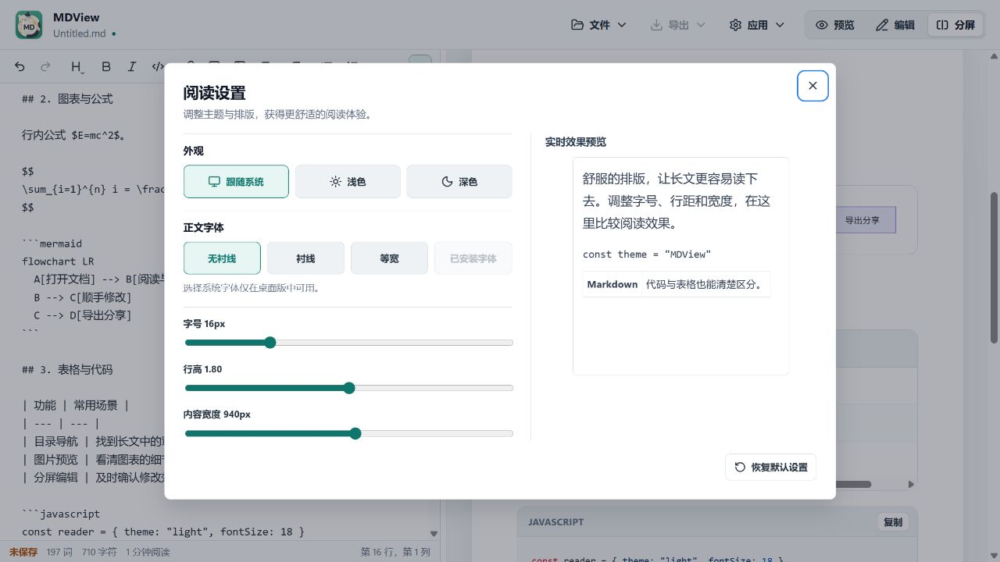

# MDView v3.6.0 体验检查

日期：2026-10-23。检查基线：`c453edd`。

这次最值得先做的，是让“读到这里 → 改这一段 → 确认已保存”更连贯。现有目录、公式、Mermaid 和图片预览已经能组成完整阅读流程，主要问题集中在状态提示、视图切换和键盘操作。

## 范围与证据

使用当前工程启动本地前端，在独立的应用内浏览器页中检查，视口为 1280×720。只输入本轮创建的演示稿，未打开安装版中的个人文档，也未读取个人最近文件记录。以下六张 PNG 都是本轮直接采集的界面，保存后已逐张打开核对。

桌面原生文件选择、写盘、Word 转换组件和系统打印窗口没有在本轮操作；相关意见明确标为代码检查，不能当作桌面实机验证。浏览器中的“打开”和“导出”按钮禁用是运行环境限制，没有列为桌面产品缺陷。没有修改业务代码。

## 检查步骤

| 步骤 | 操作 | 体验判断 |
| --- | --- | --- |
| 1 | 打开干净的开始页 | 入口简洁，最近文件空状态清楚；原生打开未验证 |
| 2 | 新建文档 | 需要优化：无文件路径时显示“已保存”，中文界面预填英文正文 |
| 3 | 输入演示稿，预览并用目录跳转 | 阅读结构清晰；切到预览后看不到持续的未保存标记 |
| 4 | 双击 Mermaid 打开单独预览 | 预览成功，提供缩放、保存、翻页入口；原生保存未验证 |
| 5 | 打开阅读设置，按 Tab，然后关闭 | 需要优化：焦点进入背景按钮，正文效果也被弹窗遮挡 |
| 6 | 从图表章节切换到分屏 | 需要优化：本轮演示稿回到开头；左右区域比例固定 |
| 7 | 核对最近文件、未保存确认与导出代码 | 仅代码检查：发现可改善的恢复流程和格式说明，原生对话框未验证 |

### 1. 开始页

“新建”和“最近打开文件”容易辨认。浏览器环境下不能打开原生文件，因此没有用该状态评价安装版的打开体验。

### 2. 新建文档

刚新建、尚未选择保存路径，左下角已经显示绿色“已保存”。中文界面中还预填了 `# Untitled` 和英文提示，这些提示实际属于正文，容易跟随第一次保存进入文件。

### 3. 阅读与目录

目录层级、当前章节样式和正文层次清楚。演示稿此时已经修改但未保存，界面内的标题仍只显示 `Untitled.md`；浏览器标签有星号，但应用自身的可见工具栏没有相应提示。

### 4. 图表预览

双击后能打开图表；翻页位置、缩放和保存按钮集中在下方，关闭按钮醒目。打开时焦点进入关闭按钮，关闭后回到原图表，这一套现有处理值得复用到其他弹窗。本轮未验证原生保存、所有缩放边界或触控操作。

### 5. 阅读设置

打开设置后，焦点没有进入设置窗口；按一次 Tab，焦点落在右上角被遮罩覆盖的“预览”按钮上。截图中的蓝色焦点框可见。关闭设置后，焦点也没有恢复到打开它的菜单入口。

设置按外观、字体、版面分组，容易理解。不过弹窗遮住了正文的主要区域，调整字号或内容宽度时，难以直接比较真正要阅读的段落。

### 6. 分屏

切换前停在第 2 节“图表与公式”（见步骤 4、5 的背景）；点击分屏后，两侧回到文档开头。左侧光标状态仍显示第 62 行，进一步增加“我现在准备改哪里”的判断成本。复现范围为本轮新建演示稿，已保存本地文档仍需桌面复查。

分屏具备同步滚动入口，但左右分界没有拖动控制。默认左侧 42%，工具栏在当前宽度下也比较拥挤。

## 优先改进清单

P1 表示建议优先安排，P2 表示后续一轮改善；不是安全漏洞等级。

### P1-1：明确区分“尚未保存到文件”和“没有新修改”

证据：步骤 2、3；界面与代码均确认。

新建文档的 `path` 为 `null`，但 `isDirty` 为 `false`，状态栏仅凭 `isDirty` 决定是否显示“已保存”。修改后切到预览，编辑状态栏又被隐藏，应用内没有持续的未保存标记。

建议：新文档显示“尚未保存到文件”，首次保存后再显示“已保存”；标题旁在所有视图中保留未保存圆点或文字。模板说明改为随界面语言变化的编辑器占位提示，避免作为正文存入文件。不要把本地草稿备份与已写入原文件混为同一种状态。

位置：[documentState.ts](../../src/domain/documentState.ts#L10)、[EditorStatusBar.tsx](../../src/components/editor/EditorStatusBar.tsx#L43)、[AppToolbar.tsx](../../src/components/shell/AppToolbar.tsx#L79)、[App.tsx](../../src/App.tsx)。

### P1-2：切换视图时跟随当前阅读段落

证据：步骤 4、5 → 6；演示稿中实测复现。

读到图表附近想改一句，切到分屏后需要重新找位置。分屏同步目前默认以编辑器为来源，进入分屏后会再次安排同步，可能覆盖预览原来的阅读位置。

建议：切换前记录正文顶部或当前章节对应的源码行，进入分屏时先按该行定位两侧，再启动同步；从编辑切回预览则跟随光标所在段落。已有的源码行与预览块映射可以继续使用。

位置：[useSplitScrollSync.ts](../../src/hooks/useSplitScrollSync.ts#L46)、[进入分屏时的同步](../../src/hooks/useSplitScrollSync.ts#L222)。源码表明存在默认方向，但完整触发链仍需实现修复时验证。

### P1-3：统一弹窗的键盘焦点管理

证据：步骤 5 的截图与键盘焦点记录；代码确认。

阅读设置虽然声明为模态窗口，却没有把焦点移进去，也没有限制 Tab 留在窗口中。键盘用户可以操作遮罩后面的控件，画面与操作对象不一致。

建议：打开时聚焦关闭按钮或首个设置项，Tab / Shift+Tab 在弹窗内循环，背景不可交互，关闭后恢复触发点焦点。复用图片预览已经实现的处理，并逐个核对其他弹窗，而不是只补当前窗口。

位置：[ReadingSettingsDialog.tsx](../../src/components/dialogs/ReadingSettingsDialog.tsx#L77)、可复用参考 [MediaPreviewDialog.tsx](../../src/components/preview/MediaPreviewDialog.tsx)。本轮没有运行读屏软件，不作完整无障碍合规结论。

### P2-1：未保存时提供“保存并继续”

证据：步骤 7，代码确认；本轮未操作桌面确认框。

打开其他文档或新建时，当前流程只用 `window.confirm` 询问是否丢弃修改。想先保存的用户需要取消、保存、再次执行原操作。

建议：提供“保存并继续 / 不保存 / 取消”，保存完成后接着执行原来的打开、新建或跳转；保存失败或取消选择路径时留在当前文档。

位置：[useDocumentController.ts](../../src/hooks/useDocumentController.ts#L80)。

### P2-2：让最近文件打开失败后仍可重试

证据：步骤 7，代码确认；没有访问用户真实最近文件。

目前最近文件只要打开抛错，就会从记录中移除。临时断开的移动盘、网络盘或暂时不可用的文件，也会走同一条路径。

建议：保留记录并显示“暂时无法打开”，提供重试、定位文件和单独移除；让用户决定何时删除记录。投屏或截图时，可再增加临时隐藏最近文件的入口，减少个人文件名外露。

位置：[useDocumentController.ts](../../src/hooks/useDocumentController.ts#L300)。

### P2-3：分屏比例允许拖动并记住选择

证据：步骤 6；界面与 CSS 确认。

当前使用固定的左侧 42% 布局。源码较长、宽表格较多时，用户无法把空间分给当前重点；工具栏在窄编辑区中也缺少明显的溢出入口。

建议：加入可拖动且支持键盘的分隔条，提供一键均分；过窄时把次要格式项收进“更多”，并记住用户选择的比例。

位置：[App.css](../../src/App.css#L453)。现有目录面板的分隔条可以作为一致的交互参考。

### P2-4：调整阅读设置时能立即看清效果

证据：步骤 5；界面观察。

建议在设置内加入短段落、代码和表格的实时示例，或改为保留正文可见空间的侧边设置面板。先加入示例成本较低，适合与焦点修复一起完成。

位置：[ReadingSettingsDialog.tsx](../../src/components/dialogs/ReadingSettingsDialog.tsx#L97)。

### P2-5：导出前说明差异，导出中防止重复触发

证据：步骤 7，代码确认；本轮没有生成原生导出文件。

Word 导出的代码分支会把 Mermaid 当作普通代码块；导出菜单本身只列格式名称。读者在预览里看到图，选 Word 后可能得到代码，预期容易落空。另外，各导出操作会显示准备状态，但没有共享的忙碌锁。

建议：检测到 Mermaid 时，在选择 Word 前说明当前图表处理方式；正在准备导出时显示明显进度并阻止重复触发。完成后提供“打开文件 / 打开所在文件夹”，帮助用户确认结果。

位置：[AppToolbar.tsx](../../src/components/shell/AppToolbar.tsx#L101)、[exportDocx.ts](../../src/domain/exportDocx.ts#L272)、[useDocumentExport.ts](../../src/hooks/useDocumentExport.ts#L51)。

## 建议安排

第一轮处理三项 P1，围绕保存提示、当前阅读位置和弹窗焦点做必要回归。第二轮处理未保存确认、最近文件恢复和分屏布局。导出说明与设置预览随后补齐。

如果继续扩展阅读体验，可考虑给查找增加可见入口，以及在工程文档之间增加返回上一个阅读位置的操作；这两项本轮没有做跨文件实机验证，作为后续设计方向保留。

## 实施跟进

上述八项建议已接入工作区：

- 新建正文为空，提示采用随界面语言变化的占位文字；未选择文件位置时显示“尚未保存到文件”，预览中保留状态文字，编辑和分屏中保留标题标记与底部状态。
- 视图切换按当前正文段落或编辑光标定位；分屏分隔条支持拖动、方向键和双击均分，并记住宽度。窄工具栏提供更多工具入口。
- 阅读设置、关于、公式编辑、语法参考、草稿恢复、Word 导入、更新及新增确认窗口共用焦点管理，支持焦点循环、关闭后恢复入口，并隔离背景交互。更新安装期间保留原有的关闭限制。
- 阅读设置在宽窗口中同时展示控件与实时排版示例；窄窗口保留可滚动布局。
- 打开、新建和文档跳转遇到未保存修改时，提供保存并继续、不保存、取消；取消保存或写入失败不会继续替换当前文档。
- 最近文件失败后保留记录，允许重试、重新选择位置、单独移除；可临时隐藏名称和路径。重新选择取消时保持原记录。
- 导出增加格式说明、Mermaid 转 Word 前提示和重复操作保护；HTML、Word 导出成功后提供打开文件、打开所在文件夹。原生打开接口仅接受本次会话实际导出的文件。
- 从纯编辑模式导出 HTML/PDF 前同步最新预览，避免使用进入编辑前的旧内容。

优化后的分屏仍停在图表章节：

优化后的设置同时显示实时预览；键盘焦点停留在弹窗内：

界面回归使用本轮演示稿完成，没有打开个人文件。原生保存对话框、打开导出文件和系统打印仍需在重新构建的桌面版中进行实机验收。
