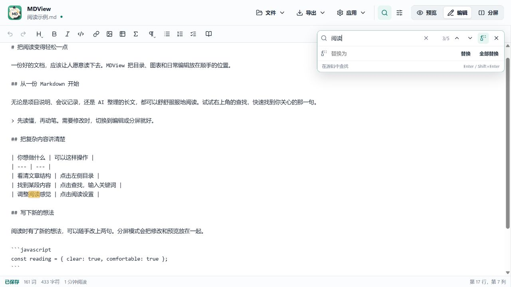
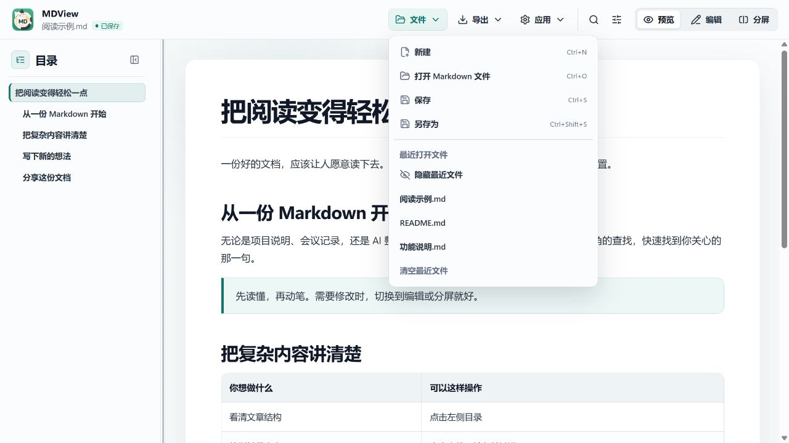
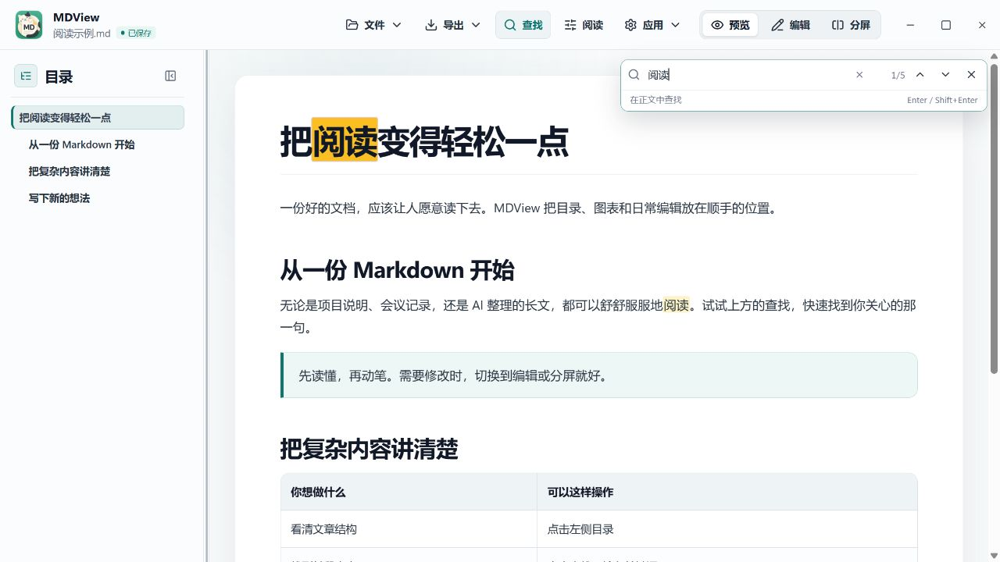
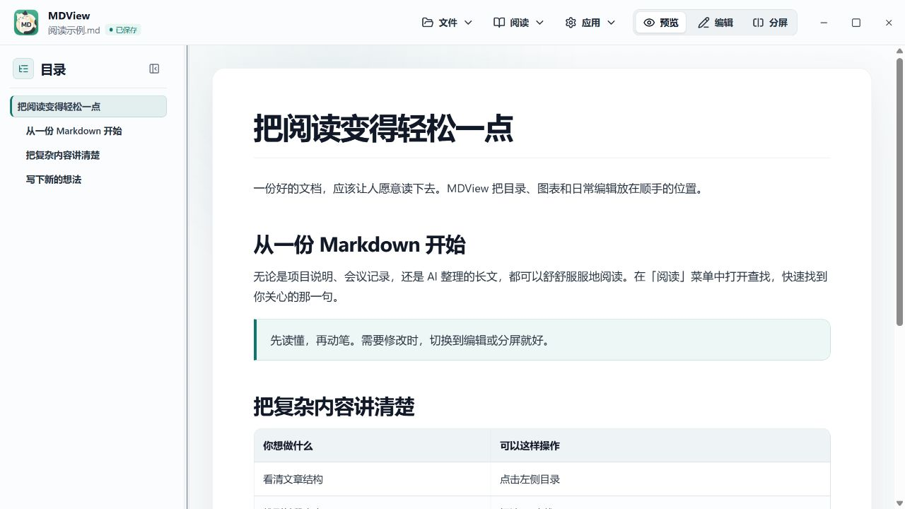
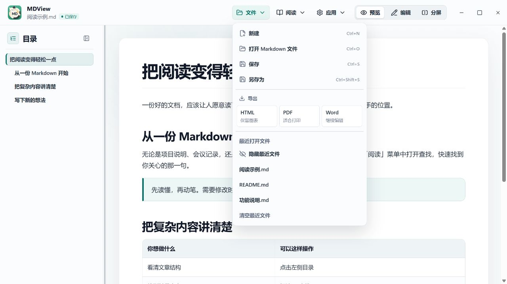
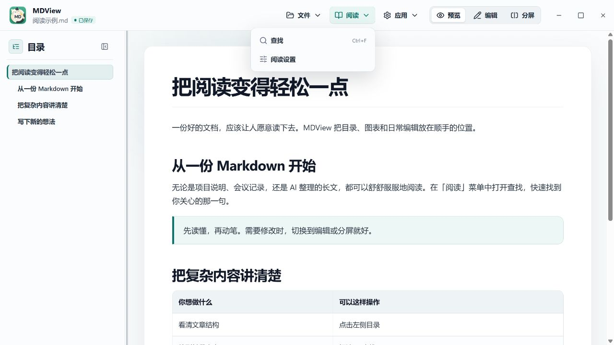

# MDView 日常操作与界面细节优化

## 本轮调整

- 工具栏增加查找、阅读设置的直接入口，选中状态更明确，图标按钮补充悬停说明。
- 文件菜单统一图标、间距和快捷键提示；语言选项增加勾选标记。
- 菜单支持上下方向键、Home / End、左右切换菜单；Esc 关闭并返回原菜单按钮。
- 导出格式与说明分行排版，长菜单可滚动，窄窗口中的菜单保持完整可见。
- 查找框区分正文与源码，增加清空、没有结果和查找中的反馈；没有结果时停用跳转按钮。
- 查找时保持输入焦点，源码当前匹配持续显示标记，定位到窗口外的结果时自动滚动；替换输入框支持回车替换。
- 保存状态使用圆点与色彩区分，视图按钮补充当前选中状态。
- 最近文件的定位、移除按钮在悬停或键盘进入该行后显示；无法打开的记录保留操作入口与提示。

## 界面记录

以下图片来自本地开发界面，使用独立的示例内容与虚构路径，不含个人文件。没有调用实际文件保存或导出操作。

### 阅读与查找

### 源码查找

### 文件菜单

## 检查记录

- 生产构建与 lint 通过。
- 在本地界面查看了浅色、深色、760px 宽度的布局，以及查找的连续输入、无结果反馈、菜单方向键和弹窗焦点返回。
- 本轮未运行自动化测试，也未进行桌面安装包验收。

## 按反馈统一工具栏

查找与阅读设置改为「图标＋文字」按钮，统一到文件、导出和应用菜单的尺寸与间距；去掉单独的分隔线，将顺序调整为文件、导出、查找、阅读、应用。查找展开时使用与菜单一致的选中样式。

窄窗口中保存状态缩为圆点，悬停仍可查看完整状态，为文件名保留空间。

## 收敛为三个菜单（最终方案）

顶部只保留「文件、阅读、应用」三个菜单，右侧仍可切换预览、编辑和分屏。

- **文件**：新建、打开、Word 导入、保存、导出和最近文件。HTML、PDF、Word 三种导出格式并排显示，保留用途说明和处理中的停用状态。
- **阅读**：查找与阅读设置。Ctrl+F / Command+F 仍可直接查找，关闭查找或设置后返回原来的操作位置。
- **应用**：界面语言、检查更新、关于。

前面的截图记录迭代过程，以下为整合后的界面。

